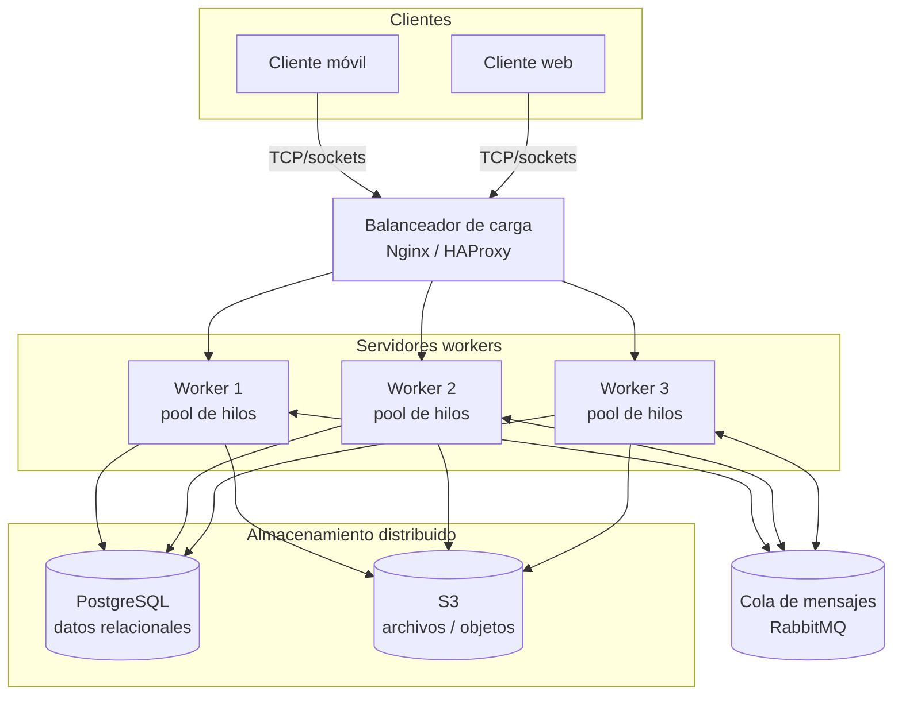

# PFO 3: Rediseño como Sistema Distribuido (Cliente-Servidor)

## Diagrama de arquitectura



**Rol de cada componente**

- **Clientes (móvil/web):** envían tareas y reciben resultados por sockets.
- **Balanceador (Nginx/HAProxy):** reparte las conexiones entre workers (round-robin) y detecta workers caídos.
- **Workers:** cada uno procesa tareas con su propio pool de hilos.
- **RabbitMQ:** comunicación asíncrona entre servidores (eventos, tareas largas, reintentos).
- **PostgreSQL / S3:** persistencia de datos estructurados y de archivos.

## Implementación en Python

`servidor.py` cumple el rol del balanceador/despachador (round-robin con reintento),
`worker.py` es el worker con `ThreadPoolExecutor`, y `cliente.py` envía tareas y recibe resultados.
Protocolo: un mensaje JSON por línea sobre TCP.

## Requisitos

- Python 3.8 o superior (`python --version` para verificarlo)
- No hace falta instalar ninguna librería: se usa solo la librería estándar.

## Cómo ejecutar

### 1. Clonar el repositorio

```bash
git clone https://github.com/<tu-usuario>/<nombre-del-repo>.git
cd <nombre-del-repo>
```

### 2. Levantar los workers (una terminal por worker)

Cada worker recibe el puerto y, opcionalmente, la cantidad de hilos de su pool (por defecto 4).

```bash
# Terminal 1
python worker.py 6001

# Terminal 2
python worker.py 6002

# Terminal 3
python worker.py 6003
```

### 3. Levantar el servidor (Terminal 4)

```bash
python servidor.py
```

Escucha en `127.0.0.1:5000` y reparte las tareas entre los workers de los puertos 6001, 6002 y 6003.

### 4. Ejecutar el cliente (Terminal 5)

```bash
python cliente.py
```

> En Linux/macOS puede ser necesario usar `python3` en lugar de `python`.

**Importante:** respetá el orden: primero los workers, después el servidor y al final el cliente.

## Salida esperada del cliente

```
Tarea 1 -> 15 (procesada por worker-6003)
Tarea 2 -> 3628800 (procesada por worker-6001)
Tarea 3 -> HOLA SISTEMAS DISTRIBUIDOS (procesada por worker-6002)
Tarea 4 -> 832040 (procesada por worker-6003)
Tarea 5 -> ERROR: Tipo de tarea desconocido: inexistente
```

Los workers que procesan cada tarea pueden variar entre ejecuciones. La tarea 5 falla a propósito para mostrar el manejo de errores.

## Probar la tolerancia a fallos

1. Con todo corriendo, cerrá un worker con `Ctrl + C`.
2. Volvé a ejecutar `python cliente.py`.
3. El servidor muestra `worker ... no disponible, probando otro` y las tareas se completan con los workers restantes.

## Tipos de tareas disponibles

| Tipo         | Datos            | Resultado                   |
| ------------ | ---------------- | --------------------------- |
| `suma`       | lista de números | suma de la lista            |
| `factorial`  | entero           | factorial del número        |
| `mayusculas` | texto            | texto en mayúsculas         |
| `fibonacci`  | entero           | n-ésimo número de Fibonacci |

Para agregar tareas propias, editá la lista `TAREAS` en `cliente.py`.

## Problemas frecuentes

- **`Address already in use`:** el puerto está ocupado por una ejecución anterior. Cerrá esos procesos o esperá unos segundos.
- **`Connection refused` en el cliente:** el servidor no está corriendo. Levantalo antes de ejecutar el cliente.
- **`No hay workers disponibles`:** no hay ningún worker activo. Levantá al menos uno.

## Estructura del repositorio

```
.
├── README.md
├── servidor.py   # recibe tareas de los clientes y las distribuye (round-robin)
├── worker.py     # procesa tareas con un pool de hilos
└── cliente.py    # envía tareas y muestra los resultados
```
